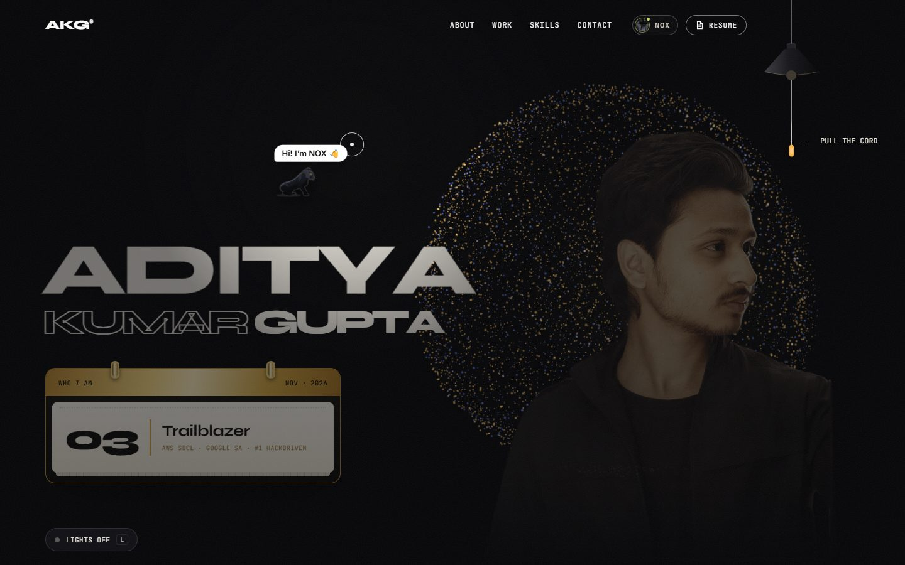
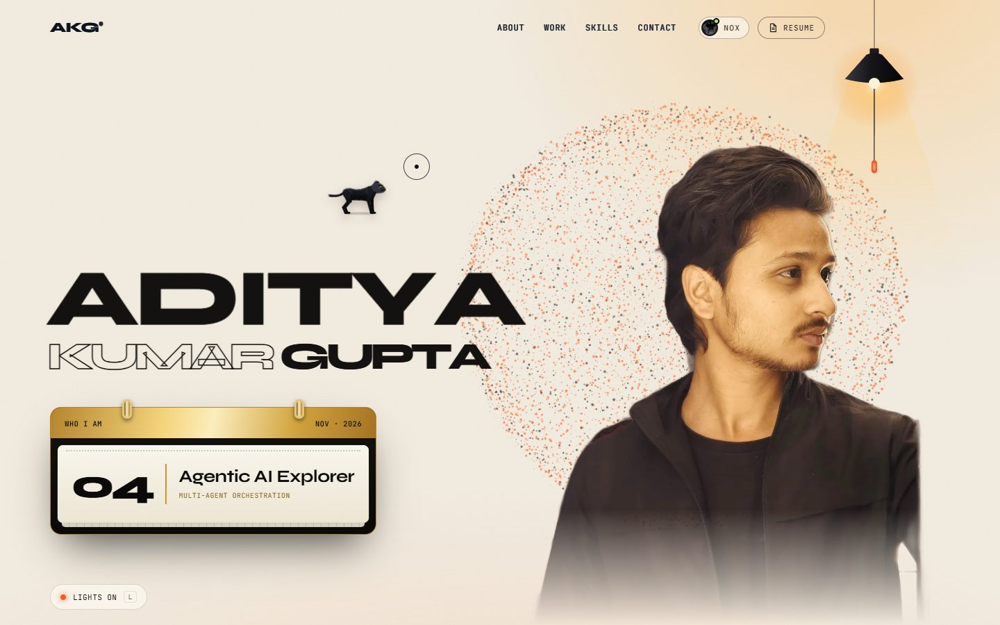
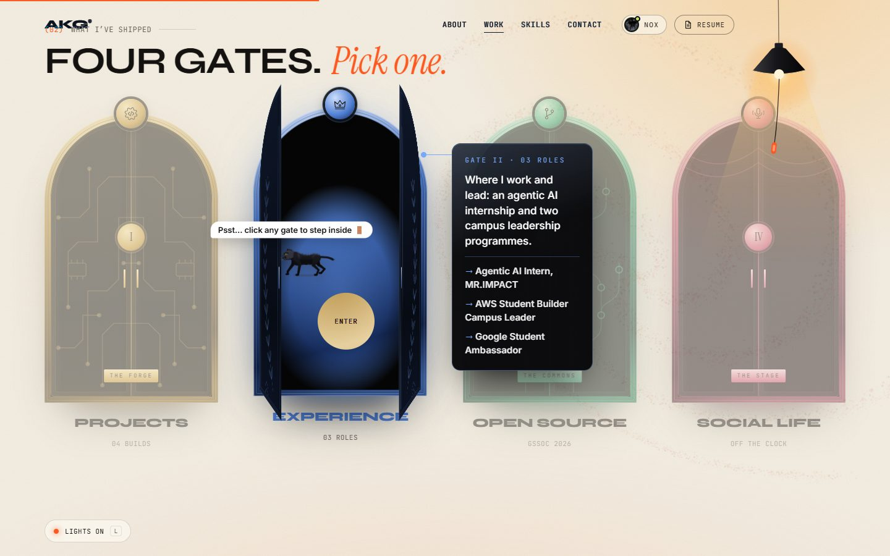
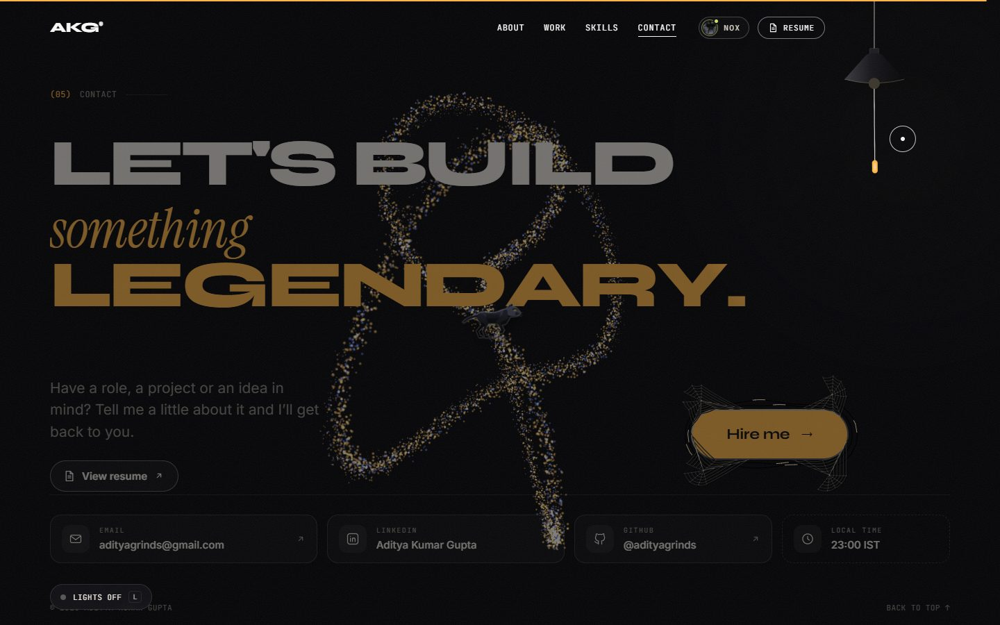
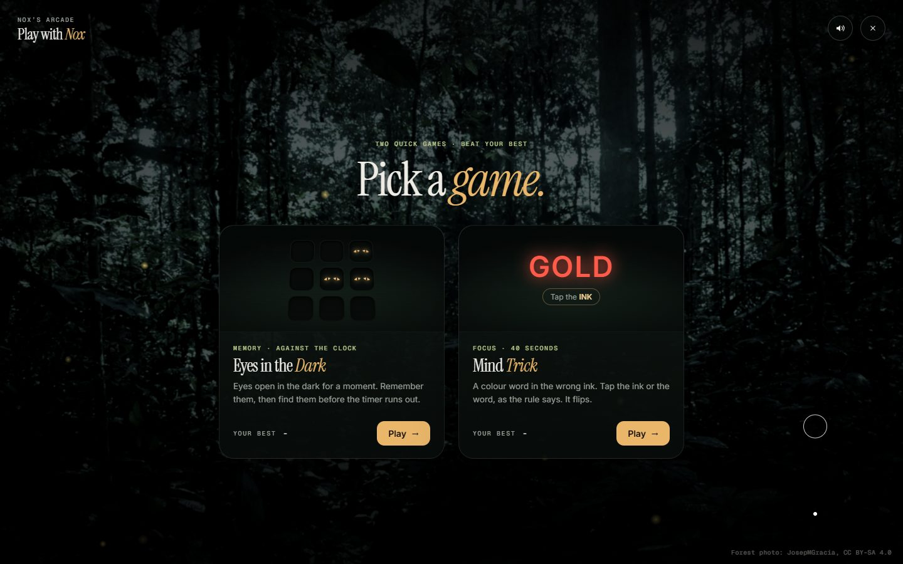
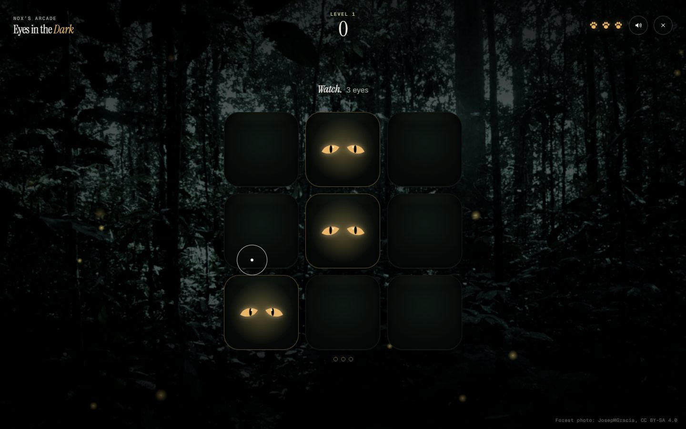
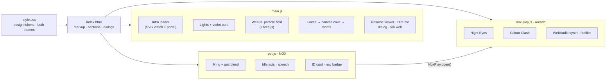

<div align="center">



# aboutaditya

### A portfolio you switch on.

The site opens in a dark room. Pull the lamp cord and it lights up.<br>
It has a panther that follows your cursor, four gates that lead into tunnels, four mind games (memory, focus, coding and maths), and a Hire me button caught in a spider web.

**Hand-built with vanilla JavaScript, WebGL and GSAP. No framework, no bundler, no build step.**

<br>

<a href="https://aboutaditya-one.vercel.app/"></a>

<br><br>


[**Live site**](https://aboutaditya-one.vercel.app/) · [**Highlights**](#-highlights) · [**Features**](#-features) · [**Architecture**](#-architecture) · [**Run it**](#-run-it-locally) · [**Deploy**](#-deploy) · [**Credits**](#-credits) · [**License**](#-license)

</div>

<br>

## ✦ Highlights

<table>
  <tr>
    <td width="50%"><br><sub><b>The intro.</b> A hand-drawn SVG dive watch counts to 100, its hands sweep to twelve, and the page warps in through a gold portal.</sub></td>
    <td width="50%"><br><sub><b>Lights on.</b> Pull the cord (a verlet-simulated rope) or press <kbd>L</kbd>. The dark room becomes a warm paper theme.</sub></td>
  </tr>
  <tr>
    <td width="50%"><br><sub><b>Four gates.</b> Hover one to open its doors. Click to fly through a canvas cave into that room.</sub></td>
    <td width="50%"><br><sub><b>Hire me, in a web.</b> Cobwebs swing on its corners. Come close and the silk reaches out and pulls your cursor in.</sub></td>
  </tr>
  <tr>
    <td width="50%"><br><sub><b>Nox&rsquo;s arcade.</b> Two mind games with live previews, sound and personal bests.</sub></td>
    <td width="50%"><br><sub><b>Night Eyes.</b> Remember where the eyes opened, then find them before the clock runs out.</sub></td>
  </tr>
</table>

<br>

## ✦ Features

### The room
- **Lights off / lights on.** The site starts dark and your cursor works as a flashlight. Pull the lamp cord or press <kbd>L</kbd> to switch to the light theme. Phones start with the lights on.
- **A particle field that changes shape.** A WebGL point cloud (Three.js) morphs into a new form for every section as you scroll. It settles and stops rendering when it isn't needed.
- **Hero.** A flip calendar cycles through roles over a background-removed portrait that warms up under the lamp. Click the portrait (cursor: *Meet me*) and an editorial profile card grows out of the photo.
- **Smooth scrolling** with Lenis, and scroll choreography with GSAP ScrollTrigger: headings rise letter by letter and paragraphs reveal word by word.

### The work
- **Four gates:** Projects, Experience, Open Source and Social Life. These are brushed-metal arches with engraved crests. Hovering lifts one gate and opens its doors. Clicking flies you through a procedural **canvas cave tunnel** into the gate's room.
- **Projects with real recordings.** Muted, looping screen captures of the live apps play inside browser-frame cards, and only while they're on screen.
- **NEO Hazard: a machine-learning case study** ([`neo-hazard.html`](neo-hazard.html)). It covers 12 trained models plus a baseline, an interactive confusion-matrix explorer, metric charts and SHAP results, with every metric computed in the browser from the real confusion matrices. It comes with a one-page research poster ([`neo-poster.html`](neo-poster.html)), exported to PDF and PNG.
- **Certificates and photos** open in a shared lightbox that grows out of the thumbnail you clicked.

### NOX, the resident panther
- **A procedurally animated black leopard** ([`pet.js`](pet.js)) that follows your cursor. It has IK legs with planted paws, a walk that blends into a rotary gallop, a flexing spine, a staged turn (head, then shoulders, then hips) and a lagging tail.
- **Idle behaviour:** grooming, yawning, stretching, loafing, pouncing at fireflies, dribbling a ball, and waving hello.
- **A field-guide ID card** with a real photo, a tilt-and-glare effect and count-up stats. You can send him home and wake him again from the footer.
- **He knows when to be quiet.** NOX never talks while you're scrolling.

### Nox&rsquo;s arcade
Four quick mind games ([`nox-play.js`](nox-play.js)) in a moonlit jungle with fireflies. The menu puts NOX's real face in the middle with the four games around him. He types out *"Let's see how smart you are"*, and his ring turns toward whichever game you point at while he comments on it.

| Game | Skill | How it plays |
| --- | --- | --- |
| **Night Eyes** | Memory, against the clock | Eyes open on a grid for a moment. Tap where they were before the timer runs out. Red eyes are traps. Each level adds eyes, the grid grows from 3×3 to 6×6, and time left over becomes a speed bonus. 3 lives. |
| **Colour Clash** | Focus | A colour word appears in the wrong ink. Tap the **ink** or the **word**, whichever the rule says, and the rule flips without warning. 40 seconds, ×2 and ×3 streak multipliers, and a wrong tap costs 3 seconds. |
| **Bug Bounty** | Coding | A little code editor with syntax highlighting. Either tap the line with the bug (it gets fixed in front of you) or predict what the snippet prints, JavaScript quirks included. Each question has its own clock. Levels bring harder code and less time. 3 lives. |
| **Math Pounce** | Maths, time attack | Quick sums, true-or-false, missing signs and "which is bigger?". A right answer adds 2 seconds and a wrong one takes 3. Every 6 right answers is a new level: two-step sums, squares and percentages arrive as you climb. |

In **Bug Bounty** and **Math Pounce**, **NOX joins you**. The real panther rig sits at the bottom of the screen: it leaps on right answers, runs a victory lap on streaks, cheers level-ups and shrugs off misses. Every question is generated fresh, and every answer is computed in code, so it is always right.

It has a 3-2-1 countdown, eyelid blinks, ripples, level banners, a rolling score counter, **synthesised WebAudio sound effects** (no audio files) with a mute toggle, and vibration on phones. Your best score for each game is kept in your browser.

### Getting in touch
- **A Hire me dialog** with reason chips, validation and a honeypot. It sends through Web3Forms (free) or FormSubmit. If neither works, the visitor gets a pre-filled message to open in Gmail, send from their own email app, or copy.
- **A resume viewer** that unrolls the PDF out of the button you clicked, with download and open-in-new-tab options.
- **The webbed Hire me button**, drawn on a single canvas that only runs while the button is on screen.

<br>

## ✦ Architecture



**Design principles**

| | |
| --- | --- |
| **No toolchain** | Plain HTML, CSS and JS files. Three CDN libraries pinned to exact versions. Open the file and it runs. |
| **Performance first** | WebGL pixel ratio capped at 1.5. Animation loops stop when settled or off screen (`IntersectionObserver`). Motion uses `transform` and `opacity` only. No animated blur on large elements. The cursor and rope skip DOM writes when nothing moved. |
| **Accessible** | Respects `prefers-reduced-motion`. Every dialog is keyboard-navigable with <kbd>Esc</kbd> to close and focus restored. ARIA labels and live regions are in place. Games are playable from the keyboard (<kbd>1</kbd>–<kbd>9</kbd>). |
| **Responsive** | Checked at 360, 390, 768, 1024, 1280, 1440 and 1920 px, in portrait and landscape, at 100% and 150% display scaling. Touch screens get touch controls. |
| **Both themes, everywhere** | Every component has a lights-off and a lights-on style, driven by design tokens. |

<br>

## ✦ Project structure

```text
aboutaditya/
├── index.html          # the whole site: sections, gate rooms, dialogs
├── style.css           # design tokens, both themes, every component
├── main.js             # loader, lights, WebGL, scroll choreography, gates, dialogs, silk web
├── pet.js              # NOX: the procedural panther, his card and the nav badge
├── nox-play.js         # Nox's arcade: Night Eyes + Colour Clash
├── neo-hazard.html     # NEO Hazard machine-learning case study
├── neo-poster.html     # one-page research poster (source for the PDF/PNG)
└── assets/
    ├── projects/       # screen recordings + posters of the live projects
    ├── neo/            # notebook charts and the exported poster
    ├── nox/            # NOX's photo and the jungle backdrop
    ├── aws/ gsa/       # certificates
    ├── social/         # event photos
    ├── resume/         # resume PDF + preview
    └── readme/         # the screenshots in this README
```

<br>

## ✦ Run it locally

No install. Clone the repo and open it:

```bash
git clone https://github.com/adityagrinds/aboutaditya.git
cd aboutaditya
```

Then either open `index.html` directly in a browser, or serve the folder (recommended, so the hire form and video previews behave like they do in production):

```bash
# any one of these
npx serve .
python -m http.server 8080
```

**Keyboard shortcuts:** <kbd>L</kbd> toggles the lights · <kbd>Esc</kbd> closes any room, dialog or game · <kbd>1</kbd>–<kbd>4</kbd> answer in Colour Clash · <kbd>1</kbd>–<kbd>9</kbd> tap the 3×3 grid in Night Eyes.

### Configure the Hire me form

In [`main.js`](main.js), find the Hire me block:

```js
const HIRE_TO = 'adityagrinds@gmail.com';
const WEB3FORMS_KEY = '';   // paste the free access key from web3forms.com
```

- **With a Web3Forms key**, messages go straight to your inbox from anywhere (free tier: 250 a month).
- **Without a key**, the form uses FormSubmit. It only works on a hosted URL, and the first message sends an *Activate form* email that has to be confirmed once.
- **If both fail**, visitors still get one-click **Open in Gmail**, **Email app** and **Copy message** options.

<br>

## ✦ Deploy

The live site runs on **Vercel**: **[aboutaditya-one.vercel.app](https://aboutaditya-one.vercel.app/)**.

It's a static site, so any static host works:

- **Vercel / Netlify:** import the repo with no framework preset, no build command, and `.` as the output directory.
- **GitHub Pages:** *Settings → Pages → Deploy from a branch → `main` / root*.

After changing CSS or JS, bump the `?v=` query on the asset links in `index.html` so returning visitors get the new files.

<br>

## ✦ Credits

| What | Source |
| --- | --- |
| Jungle backdrop in the arcade | *Tropical rainforest in Sangha Trinational* by **JosepMGracia**, [CC BY-SA 4.0](https://commons.wikimedia.org/wiki/File:Tropical_rainforest_in_Sangha_Trinational.jpg), colour-graded to night |
| NOX's photo | *Black leopard, Padmaja Naidu Himalayan Zoological Park* by **Ashmita Panda**, [CC BY-SA 4.0](https://commons.wikimedia.org/wiki/File:Black_leopard,_Padmaja_Naidu_Himalayan_Zoological_Park.jpg) |
| Libraries | [Three.js](https://threejs.org) r128 · [GSAP](https://gsap.com) 3.12.5 + ScrollTrigger · [Lenis](https://github.com/darkroomengineering/lenis) 1.1.13 |
| Type | Syne · Inter · Instrument Serif · JetBrains Mono · Fraunces · Geist · Geist Mono, via Google Fonts |

Everything else, including the watch, the gates, the cave, NOX's rig, the games, the web and the sound effects, is drawn or generated in code.

<br>

## ✦ License

| Part | License |
| --- | --- |
| **Source code** (`*.html`, `*.css`, `*.js`) | [MIT](LICENSE). Use it, learn from it, build on it. Keep the copyright notice. |
| **Personal content**: my photos, resume, certificates, event photos, project recordings and the written copy | © Aditya Kumar Gupta, all rights reserved. Please don't reuse these. |
| **Third-party photos** (jungle backdrop, NOX's photo) | Under their own CC BY-SA 4.0 licenses, credited above |

If you build something from this code, a link back is appreciated, but not required.

<br>

## ✦ Author

<table>
  <tr>
    <td>
      <b>Aditya Kumar Gupta</b><br>
      Full-stack engineer building real-time systems and multi-agent AI.<br>
      1st place at Hackbriven · NASA Space Apps National Finalist · AWS SBCL · Google Student Ambassador
    </td>
  </tr>
  <tr>
    <td>
      <a href="https://www.linkedin.com/in/aditya-kumar-gupta-048a96371/"></a>
      <a href="https://github.com/adityagrinds"></a>
      <a href="mailto:adityagrinds@gmail.com"></a>
    </td>
  </tr>
</table>

<br>

<div align="center">

**[See it live →](https://aboutaditya-one.vercel.app/)**

**If something here made you smile, a ⭐ goes a long way.**

<sub>Code under the MIT License · personal content © 2026 Aditya Kumar Gupta</sub>

</div>
